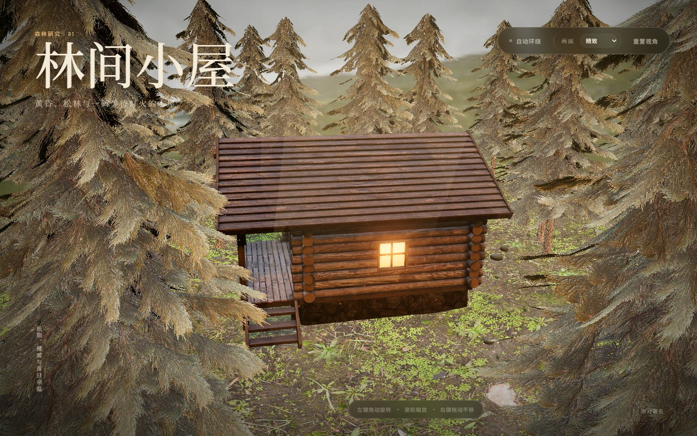
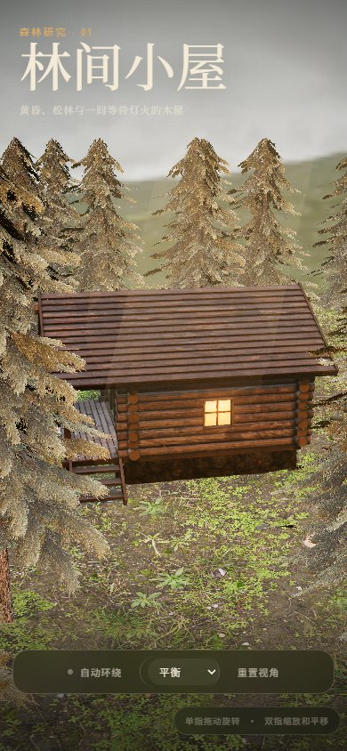

# 林间小屋

一个可直接在浏览器中运行的可旋转 3D 林中小屋场景。使用 Three.js
渲染原木小屋、松林地形、落日 HDRI 和灯光氛围，并提供鼠标与触控环绕、
缩放、平移、自动环绕、画质切换与视角重置。

## 在线体验

- 场景：[https://Yoilov3r.github.io/forest-cabin/](https://Yoilov3r.github.io/forest-cabin/)
- 源码：[https://github.com/Yoilov3r/forest-cabin](https://github.com/Yoilov3r/forest-cabin)





## 运行

```bash
pnpm install
pnpm dev
```

打开 `http://127.0.0.1:5173`。

生产构建：

```bash
pnpm build
pnpm preview
```

构建产物使用相对资源路径，可以直接部署在 GitHub Pages 等静态站点的子目录中。

## 部署

推送到 `main` 分支后，GitHub Actions 会执行类型检查、生产构建并发布
`dist/` 到 GitHub Pages。首次发布前需要在仓库的 Pages 设置中把 Source
设为 **GitHub Actions**。

## 操作

- 鼠标左键拖动：环绕小屋
- 鼠标滚轮：缩放
- 鼠标右键拖动：平移
- 触控单指拖动：环绕
- 触控双指：缩放和平移
- 双击画布：重置视角

## 技术栈

- Three.js 0.180
- TypeScript 5.9
- Vite 7

## 场景内容

- 可绕行的原木小屋、松林地形与野餐桌
- 落日森林 HDRI、方向光、雾、窗灯和门廊灯
- 松林近景消隐，减少环绕时树枝穿过镜头的遮挡
- 草叶、蕨类、岩石、林间小径、木柴、烟尘和体积光
- 高、中、低三档画质
- 加载进度、失败提示、素材署名和响应式控制栏

## 目录

```text
.github/workflows/ GitHub Pages 自动发布
docs/            桌面端与移动端预览图
public/assets/   3D 模型与 HDRI
scripts/         本地浏览器验收脚本
src/main.ts      Three.js 场景与交互
src/style.css    页面与响应式界面
```

素材来源和授权信息见 `CREDITS.md`。当前实现状态与后续建议见
`CODEX_HANDOFF.md`。
